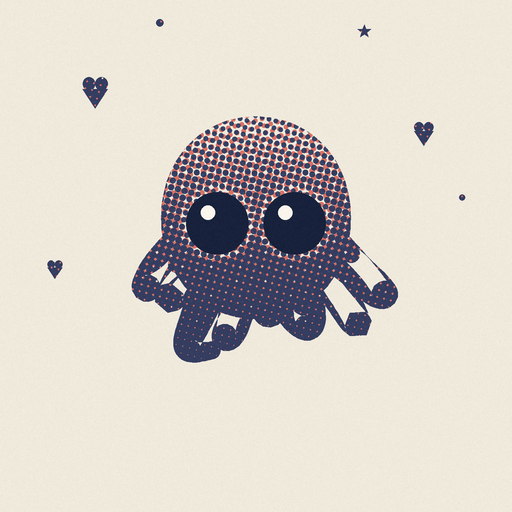

# Glass Octopus — 印刷小品

从 claude.dev 那只机器人拆出来的设计经验，做的章鱼小品。**一套骨架，六种印刷方式。**


打开 `index.html` 即可，`file://` 直接能跑，不用起服务器。点任意一张看大图。

---

## 先说原来那只机器人

拆开看，信息量极小：

| | 原站机器人 |
|---|---|
| 格式 | Lottie，4 图层，**零位图资源**，全矢量 |
| 配色 | **两个颜色**：`#141413` 近黑 + `#d97757` Anthropic 橙 |
| 造型 | 每层一个纯色填充层，用离散色块拼出像素画轮廓 |
| 尺度 | 画布 2750×1850，形象实际约 136×91，每块约 20 单位 |

它的好**不来自细节，来自约束**：两个颜色、一个动作、清楚的重心、会动的眼睛。

---

## 这一版往"可爱"调了什么

改的不是颜色，是比例和拓扑：

| | 原来是 | 现在是 | 为什么 |
|---|---|---|---|
| 眼睛 / 头 | 0.50 | **0.34** | 太大会顶到头沿，切出"帽檐" |
| 眼睛位置 | 偏上 | **压到下半** | 上方留额头，眼睛就不会把脸切成两半 |
| 眼球间距 | 0.40 | **0.42** | 中间要留出一张脸，不能挨在一起 |
| 头 / 画面 | 0.145 | **0.180** | 另一半可爱感来自头占身体的比例 |
| 头的位置 | 偏上 | **压低** | 触手才会垂在下面，而不是挤在两侧 |
| 头形 | 两个椭圆 | **一个圆顶** | 见下 |
| 触手 | 长而尖 | **短而圆**，更卷 | 圆头不扎人 |
| 触手开角 | 1.15π | **0.56π** | 收窄，才像垂着而不是张出去 |
| 触手起点 | 头心附近 | **头下半** | 起点太高，肩线会变成帽檐 |
| 明暗 | 头与触手两段 | **一整条竖直渐变** | 两段就在交界处留一道横线 |

还加了飘在周围的小东西 —— 爱心、星星、泡泡、闪光。**它们是画进覆盖率场里的**，
和章鱼共用同一套色版，所以网点、网线都照常穿过它们。画在上层就成贴纸了。

### "看着像戴帽子"是怎么来的

你连着说了两次，第一次我改错了方向。最后发现是四个原因叠在一起：

**一、眼睛太大，顶到头的两边。** `eye_r` 原来是 0.50，眼球直径几乎等于头宽，位置
又偏上。头的上沿被眼球切线切出一条窄带 —— 那条带就是"帽檐"。
**这个只在把头单独画出来、去掉网点之后才看得出来**，所以我加了
`tools/preview-shape.py`，专门渲染不带任何印刷效果的剪影。前两轮我一直在印刷图上
判断形状，等于隔着一层网点猜。

**二、触手起点太高、开角太宽。** 肩线是一条横贯的直线，正好压在头顶下方。开角从
1.15π 收到 0.56π、起点移到头的下半之后，触手变成"垂下来"而不是"张出去"。

**三、明暗分了两段。** 覆盖率场原来给触手单独加了一档亮度，交界处就留了一道横线。
改成整只一个竖直渐变之后，那条线没了。**这条最隐蔽** —— 形状改对了、明暗没改，
看起来仍然有分界。

**四、头原本是两个椭圆拼的。** 两个椭圆的并集在相接处有一道轻微的腰，而所有印刷
风格都在给这个并集做网点，那道腰就被印成了一条横线。头现在换成了**一条闭合轮廓**
（超椭圆，指数 2.08），内部完全没有边缘。

指数是控制"方"的唯一参数，而且涨得很快 —— 2.0 是椭圆，过了 2.4 就开始像圆角箱子。
**顶部越平越显方，所以关键是让头顶一直保持弧线**，而不是去修圆角。

### 还有一处：眼睛周围印出了一个方框

眼睛区域要压暗（让实心眼球压在网点之上），原来用的是**矩形**范围，于是雕刻和网点
版上都印出了一个直角方框。改成**椭圆衰减**才对 —— 这个风格最不能出现的就是脸上的
直线。

---

## 六种印刷方式

都是真的在算覆盖率，不是叠一层纹理：

| | 做法 | 为什么这么像 |
|---|---|---|
| **爱心** | 两色网屏，15° 和 75° | 错开几个像素的套印误差 |
| **星星** | 四色分色，15/75/0/45° | **这四个角度是必须的**，换一组玫瑰斑就变成摩尔纹 |
| **泡泡** | 随机网点（FM 调频） | 没有网格，靠点的密度而不是大小 |
| **综合** | 粗网 + 灰底新闻纸 | 整版还有轻微漂移，不只是色版 |
| **雕刻** | 三组交叉网线，单色 | 大面积实墨，只在头部排线 |
| **小票** | 方形点阵 + 横ruling + 齿孔 | 针式打印头就是方阵 |

### 关键：网点是"大面积实墨 + 用点调子"，不是"给照片打一层点"

这一版最难搞对的就是这一点，来回改了四次。

网点的覆盖率和透明度不是一回事：**覆盖率是"这块区域多少比例是墨"**。所以覆盖率
0.5 已经是一半是黑，不是"淡淡的"。我第一版按"渐变的 alpha"去理解，把 crown 调到
1.0、bottom 调到 0.26，算出来是"上亮下暗"，实际印出来是一团实心墨 ——
**点连成片，网点就没了，只剩一个带纹理的剪影。**

反过来也一样：bottom 一往 1.0 推，覆盖率塌到接近 0，章鱼就变成一只苍白的鬼。

正确的模型是：**整只印成一大块墨，用网点的大小来调制它**，头部开一点让高光透出来。
现在 `RAMP = (1.00, 0.02)`，实测覆盖率落在 0.35–1.0 之间。

### 还有一个更根本的问题：这份代码里有两个网点渲染器

- `styles.draw_halftone` —— 九种动画画法用的那份，**从来没有用过我的 ramp**
- `prints.coverage` —— 六张静帧用的那份，我一直在改它

所以"会动的那版更好"是有道理的：它一直是原始行为，而我改的是另一条路，两边越改
越不像。现在**合并成一个**，`styles.draw_halftone` 直接调用
`prints.draw_halftone`。同一个姿势，精灵帧和海报现在是同一张图的两个尺寸。



### 两个踩过的坑

**一、雕刻必须反过来做。** 一开始我用通用的覆盖率场去驱动网线，结果触手全是空心
轮廓 —— 网线单位面积吃的墨比同间距的网点少得多，覆盖率不够就只描了边。改成
**先取实心**：四肢整体压满，只在头部保留渐变网线。雕刻本来就是大面积实墨、阴影处
才用排线。

**二、覆盖率必须裁进轮廓。** 触手权重的笔触比触手本身宽，不裁的话会溢出到肢体
外面，印出一圈不属于章鱼的halo。三处都补了 `* mask`。

---

## 批量生成

```powershell
python octopus/tools/cute-prints.py       # 六张静帧印刷稿 + 九宫格对照图
python octopus/tools/make-octopus.py      # 九种会动的画法（页面下半部分）
node   octopus/tools/verify-octopus.mjs   # 验收
```

两个生成脚本都是幂等的，各自把数据写进 `index.html` 对应的标记之间
（`/*PRINTS:BEGIN*/` 和 `/*META:BEGIN*/`），只替换中间那段。

> 注意：直接手写 `index.html` 会把这两段数据清空。改完页面要重新跑一次两个脚本。

验收脚本**用 HTTP 起页面而不是 `file://`**：从磁盘加载的图片会污染 canvas，
`getImageData` 直接抛异常，那样量的是安全错误而不是画面。

最近一次结果：

```
6 张印刷稿，全部 512×512 正确解码
点图放大可用，点击关闭，Esc 关闭
9 种动画画法全部渲染且逐帧变化
错误: 无
```

---

## 文件

```
octopus/
├── index.html                    预览页（六张印刷稿 + 会动的画法）
├── assets/
│   ├── cute-<方式>.png           六张静帧印刷稿，512×512
│   ├── octopus-<画法>.png        九条动画精灵表，4608×384
│   ├── cute.json / octopus.json  元数据（页面里内联了一份）
└── tools/
    ├── rig.py                    骨架：比例、呼吸、八条触手、装饰、轮廓
    ├── prints.py                 网点/网线/随机屏的公共部分
    ├── styles.py                 九个动画渲染器
    ├── cute-prints.py            六张印刷稿
    ├── make-octopus.py           生成动画精灵表
    ├── preview-shape.py          只渲染剪影，用来判断形状
    └── verify-octopus.mjs        验收
```

`preview-shape.py` 是这次加的工具：**改形状的时候不要看成品**。印刷稿上的网点会
盖住轮廓，前两轮我就是在网点上判断形状，所以连改两次都没改对。它输出纯黑剪影、
头轮廓线、眼睛位置和头部的宽高比，一眼就能看出哪儿方了。

骨架和渲染是分开的。加一张新印刷稿，在 `cute-prints.py` 里写一个
`piece_xxx()`，注册进 `PIECES` 和 `LABELS`，跑一次生成即可 —— 比例、动作、装饰
都不用碰。

---

## 已知取舍

- **雕刻版四肢是实心的**，只有头部有排线。真雕刻会在四肢也留排线，但那需要按曲率
  逐段控制线段方向，成本远高于收益。
- **小票版的横 ruling 是均匀的**，真票据的走纸会有累积误差，越往下越偏。
- **六张都是单帧**，同一姿势。骨架本来会呼吸，静帧只是取了相位 0；要让六张姿势
  各异，把 `piece_xxx(phase=...)` 的相位调开即可。
